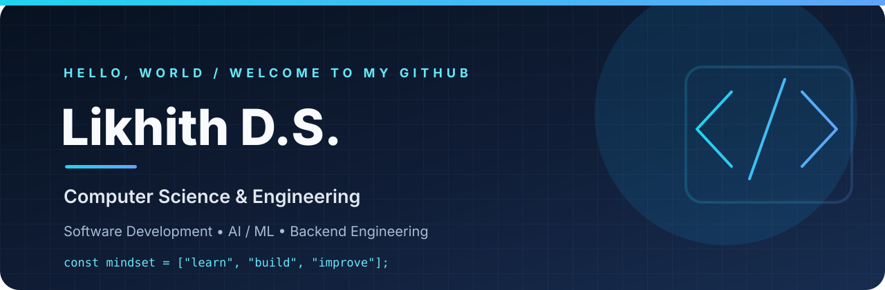

  

  

  
  
  

---

## 👨‍💻 About Me

Hello! I'm **Likhith D.S.**, a Computer Science and Engineering student at **Siddaganga Institute of Technology, Tumakuru**.

I enjoy turning ideas into practical applications, solving programming problems and exploring how AI can make software more useful.

- 🎓 B.E. — Computer Science and Engineering
- 💡 Interests: Software Development, AI/ML and Backend Engineering
- 🧩 Core subjects: DSA, OOP, DBMS, Operating Systems and Computer Networks
- 🌱 Learning through hands-on projects and coding practice
- 🚀 My approach: **Learn → Build → Test → Improve**

## 🧰 My Tech Toolbox

<b>PROGRAMMING</b>

  

<b>FRONTEND · BACKEND · DATABASE</b>

  

<b>TOOLS & ENVIRONMENT</b>

  

## 🚀 Featured Builds

<table>
<tr>
<td width="50%" valign="top">

### 🎓 E-VISTA
**AI-assisted educational video learning**

Discover educational content and turn it into useful learning material with transcription, summaries, translation, quizzes, flashcards and Q&A.

**Stack**  
React · FastAPI · Whisper · Gemini · SQLite

</td>
<td width="50%" valign="top">

### 🧠 MeetingMind AI
**Meeting summarizer & action tracker**

Transform meeting transcripts into structured summaries, key decisions, action items, owners, deadlines and transcript-grounded Q&A.

**Stack**  
Python · Streamlit · Ollama · Qwen2.5

</td>
</tr>
</table>

<i>Explore my repositories for source code, setup instructions and ongoing experiments.</i>

## 📈 GitHub at a Glance

  
  

  

  

## 🧠 Problem Solving

  
  
  

## 🎓 Education

**Siddaganga Institute of Technology · Tumakuru**  
Bachelor of Engineering — Computer Science and Engineering

## 🤝 Connect & Explore

  
  

<b>Thanks for visiting — let's keep building. ✨</b>

